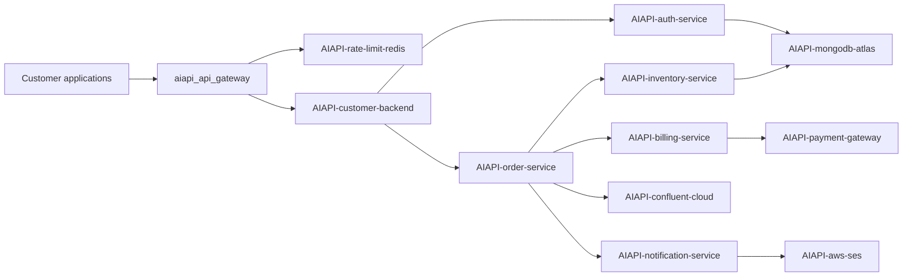

# AIAPI nested tracing and dependency errors

Build `AIAPI-dependency-tracing-v5` enables expanded tracing by default.
These are generated application workflows, not discovered customer architecture.
The stream remains offline unless explicitly launched with `--live`.

## Trace topology

Every request that reaches the backend includes all six application dependencies
and the external calls below. Together with Redis and the backend, this exceeds
five distinct dependencies. Gateway deadline rejections deliberately omit the
backend and all its descendants: a timeout cannot claim work that never ran.



Application RPCs have a caller-owned CLIENT span and a callee-owned SERVER span,
with propagated trace ID, explicit parent span ID, `peer.service`, `server.address`,
HTTP method/route/status, and stable service identities. Nested calls use the
receiving SERVER span as their parent. The longest application path has nine
parent links from the caller root. Standard service-graph processors can infer
these application edges from paired RPCs.

MongoDB, Kafka and SES use caller-owned CLIENT spans with peer metadata;
MongoDB adds `db.system.name`/`db.operation.name`, Kafka adds messaging system,
operation and destination. No server instrumentation or HTTP request count is
invented for managed systems. Virtual-node rendering for those peers depends on
the tenant's graph processor and semantic-convention support.

The existing gateway queue, CPU-wait, policy and response detail spans remain.
The expanded backend budget is eight times the CPU-only backend budget (roughly
120–320 ms, route dependent), allowing nested service work. Child intervals
partition portions of their parent; descendants do not extend a completed parent
or add time twice. At most one explicit retry is allowed per dependency call.

## Time-varying error bubbles

| Dependency | Launch offset | Maximum first-attempt failure probability |
| --- | --- | --- |
| Authentication | 01:00–02:30 | 22% |
| Inventory | 07:00–09:30 | 28% |
| Payment | 13:00–16:00 | 25% |
| Kafka publication | 18:00–20:00 | 24% |

Each window ramps in/out with a smooth envelope and fluctuates on a shorter
cadence; individual attempts use a separate seeded RNG. Probabilities are bounded,
not fixed error flags on every request. Outside these windows the injected
probability is zero. With `AIAPI_REPEAT_INCIDENT=true`, offsets repeat each episode;
otherwise no dependency error window repeats after final recovery.

A failed first attempt gets ERROR span status, an exception event, a 503 RPC status
(or `dependency.status_code` for non-HTTP peers), and
`error.type="TransientDependencyUnavailable"`. The immediately following attempt
has `retry.attempt=2`, succeeds, and has its own interval/span/metrics/log entry.
Descendant calls run only inside the successful attempt. The enclosing application
operation can therefore succeed while a dependency edge shows errors. Gateway
504s remain separate `GatewayDeadlineExceeded` errors and do not fabricate
backend activity. Redis stays healthy.

Trace budgets refill at 90/minute each for gateway errors, recovered dependency
errors, and slow requests, plus 18/minute for ordinary requests. Each has at most
five seconds of initial burst. Recovered faults are prioritized even when the
root request succeeds. Every dependency-error request logs all actual attempts
regardless of trace sampling; unsampled records have no invented trace/span IDs.
An eligible healthy trace contains at least 34 spans; retries add their actual
attempt spans. More spans make live batch/export volume higher than v4.

## Metrics and lens queries

Every nested call attempt contributes once to
`aiapi_dependency_calls_total` and `aiapi_dependency_duration_seconds`, with
`source_service`, `destination_service`, `operation`, and `outcome="error|success"`.
These full-population metrics are independent of trace sampling and have no
request IDs or retry-attempt labels. Application RPCs also contribute one CLIENT
and one SERVER operation to span-duration metrics; do not sum both kinds to
estimate user requests. Managed calls contribute only CLIENT operations.

```promql
# Edge call rate; preserve both endpoint dimensions.
sum by (source_service, destination_service) (
  rate(aiapi_dependency_calls_total{application="AIAPI-api-platform"}[15s])
)
# Error bubbles / edge error volume.
sum by (source_service, destination_service) (
  rate(aiapi_dependency_calls_total{application="AIAPI-api-platform",outcome="error"}[15s])
)
# Edge error percentage: denominator includes initial attempts and retries.
100 * sum by (source_service, destination_service) (
  rate(aiapi_dependency_calls_total{application="AIAPI-api-platform",outcome="error"}[15s])
) / clamp_min(sum by (source_service, destination_service) (
  rate(aiapi_dependency_calls_total{application="AIAPI-api-platform"}[15s])
), 1e-9)
# Application service errors, using the classic span-metrics fallback.
sum by (service_name) (
  rate(traces_span_metrics_duration_seconds_count{application="AIAPI-api-platform",span_kind="SERVER",status_code="STATUS_CODE_ERROR"}[15s])
)
```

Use 10–30-second windows and short time ranges to retain bursts. To demonstrate
a complete trace, choose a request that reached the backend; an early gateway
504 intentionally has a smaller tree. To demonstrate recovered bubbles, filter
`dependency.recovered_errors > 0` on trace/root attributes and inspect ERROR child
spans. UI bubble size/color, graph discovery and OTLP label translation require
tenant configuration; they have not been verified by local tests.

For the earlier CPU-only scenario, set `AIAPI_EXPANDED_TRACING=false`. Python
invocation reads process variables; Docker Compose reads the optional local
`.env`. Restarting begins a new episode. Keep existing credentials secure.
Historical v4 captures and counts remain valid for that build; expanded backend
work changes the deadline budget and therefore can change overall 504 counts.
